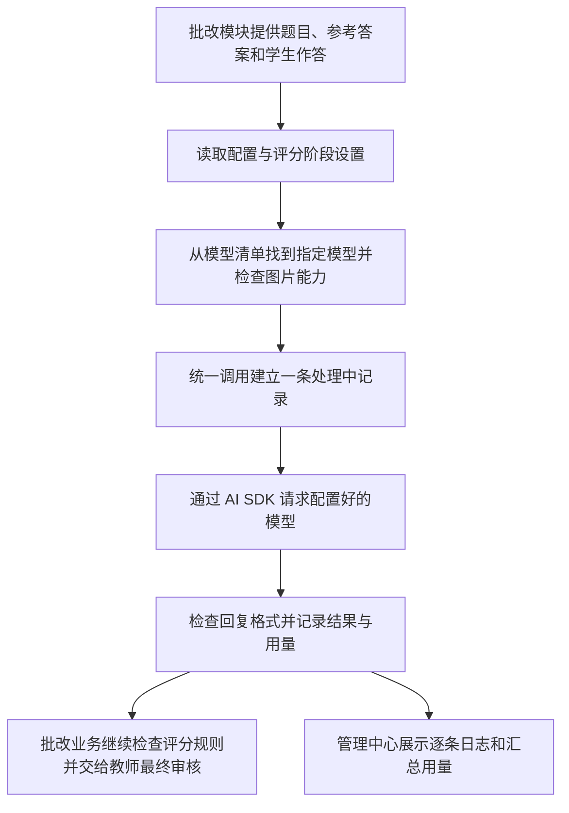

# 公共 AI 能力：概念与代码导读

这份说明适合先理解业务，再逐步认识代码。打开代码后，不需要一行行看懂，先确认“这一段在整个流程中负责什么”即可。

想在同一份文档中对照完整源码，阅读 [中文讲解与源码对照版](./AI-SOURCE-WALKTHROUGH.md)：包含当前项目实际源码、逐章说明及原文件行号定位，并提供页面和测试源码附录。

## 先理解五项能力

把平台想成一家可以找多家外部工厂加工的服务公司：业务提出需求，平台选择工厂、发送材料、接收成果，然后登记处理记录和消耗。

| 能力 | 负责回答什么问题 | 用批改举例 |
| --- | --- | --- |
| 配置管理 | 找谁提供服务、如何连接、默认用谁、不同任务如何选择 | 题目整理用哪个模型，评分用哪个模型 |
| 模型清单 | 平台允许使用哪些模型，每个模型具备什么能力 | 哪些模型能读图片，参考单价是多少 |
| 统一调用 | 业务如何通过同一个入口请求 AI 完成工作 | 把题目、答案和评分要求送给选中的模型 |
| 日志 | 某一次调用发生了什么 | 哪个任务调用了哪个模型，成功还是失败，耗时多久 |
| 用量统计 | 多次调用总共消耗了多少 | 批改模块调用了多少次，供应商报告多少输入输出量，估算费用多少 |

**配置决定怎么用，清单说明有什么可用，统一调用负责实际请求，日志记每一笔，用量统计把这些记录汇总起来。**

当前代码中，这五项不是五个完全分开的系统：配置与模型清单放在同一个配置文件里，日志与用量也共用一张数据库表。这是为了让修改和记录保持一致。

## 代码地图：从这里点击进去

| 位置 | 主要职责 | 学习时重点看什么 |
| --- | --- | --- |
| [配置与模型规则](/D:/project/AIGC工具平台/foundation/lib/server/ai/config.ts:17) | 规定一个模型、一家服务商和一份配置可以填写哪些内容 | 模型名字、图片能力、单价，以及配置错误如何被拦截 |
| [读取配置](/D:/project/AIGC工具平台/foundation/lib/server/ai/config.ts:117) | 决定使用哪份配置 | 先读部署环境，再读本地配置，没有配置时使用明确的演示设置 |
| [保存配置](/D:/project/AIGC工具平台/foundation/lib/server/ai/config.ts:130) | 检查后把配置保存到磁盘 | 保存前检查，而不是收到什么就直接保存 |
| [为当前任务选择模型](/D:/project/AIGC工具平台/foundation/lib/server/ai/config.ts:140) | 根据任务阶段找到服务商、模型和密钥 | 精确阶段、批改通用设置与默认模型的关系，以及旧批改配置兼容 |
| [公共调用准备](/D:/project/AIGC工具平台/foundation/lib/server/ai/service.ts:41) | 检查模型能力、建立本次调用记录 | 真实批改不能误用演示模型，需要看图片时先检查能力 |
| [适配不同模型服务商](/D:/project/AIGC工具平台/foundation/lib/server/ai/service.ts:98) | 把公共请求连接到不同服务商 | 业务入口统一，服务商连接方式在这里区分 |
| [实际发送 AI 请求](/D:/project/AIGC工具平台/foundation/lib/server/ai/service.ts:127) | 请求模型并处理成功、失败与结果检查 | 请求前后都围绕同一条调用记录工作 |
| [普通文本和固定格式结果入口](/D:/project/AIGC工具平台/foundation/lib/server/ai/service.ts:164) | 支持普通回复，以及必须符合约定格式的回复 | 批改需要分数、反馈等字段，不能只收到一段自由文字 |
| [逐步输出文本](/D:/project/AIGC工具平台/foundation/lib/server/ai/service.ts:178) | 支持回答一边生成一边显示 | 适合聊天；当前管理页测试按钮使用普通完整回复 |
| [记录结果与估算费用](/D:/project/AIGC工具平台/foundation/lib/server/ai/service.ts:68) | 更新状态、耗时、输入输出量及估算费用 | 失败但已经消耗的用量也需要记录 |
| [日志数据库](/D:/project/AIGC工具平台/foundation/lib/server/ai/store.ts:8) | 保存每一次调用的信息 | 哪些字段属于记录，而不是把学生材料全文存下来 |
| [日志查询与用量汇总](/D:/project/AIGC工具平台/foundation/lib/server/ai/store.ts:28) | 查询最近记录、累计数字和分类汇总 | “逐条记录”和“汇总结果”来自同一份数据 |

行号是编写本说明时的位置；后续增加代码可能使行号移动，但文件职责不变。

## 1. 配置管理：告诉平台应该怎么连接和选择

配置管理相当于平台的 AI 设置中心，主要保存：

- 有哪些服务商，以及它们的接口地址。
- 每家服务商有哪些模型、是否启用。
- 平台默认使用哪个模型。
- 某个业务阶段是否指定其他模型。
- 密钥应从哪个服务端环境设置读取。

例如，你可以让“整理题目”使用模型甲，“评分”使用模型乙。这个“根据任务分配模型”的设置叫阶段路由，理解成工作分配表即可。

**配置不是提示词。** 配置决定用哪种服务；提示词则说明这次要模型做什么，例如“根据评分标准给分并说明理由”。

当前配置可以在管理页面修改，实际保存到项目根目录下的 `.ai-data/config.json`；如果部署环境设置了完整配置，则它优先，并且页面改为只读。真实密钥单独放在服务端环境变量中，配置只记住去哪里读取密钥，网页不返回密钥内容。

先看 [配置示例](/D:/project/AIGC工具平台/foundation/ai.config.example.json)，它比实现代码更容易理解；其中的地址和模型名都是占位示例，不能直接连接真实服务。

## 2. 模型清单：平台可选用的模型目录

“服务商”和“模型”是两个层次：一家服务商可以提供多个模型，不同模型在能力、速度和价格上可能不同。

每个模型目前登记：名字、服务商要求的模型编号、是否支持图片、输入输出参考单价与币种。平台选模型时只能选已经登记、且所属服务商已启用的模型。

模型清单目前由管理员维护，不会自动从互联网下载全部模型。标记“支持图片”是管理员声明，不能保证服务商实际可用；仍然要做真实连接验证。页面显示“已配置，待实测”表示所需设置已存在，不等于模型已成功响应。

相关代码从 [模型字段规则](/D:/project/AIGC工具平台/foundation/lib/server/ai/config.ts:17) 开始；当前实际清单保存在配置数据中，不是固定写死在页面组件里。

## 3. 统一调用：所有业务共用的 AI 服务窗口

有了统一调用，批改模块只需要提供这次任务的要求和材料，公共服务负责找到模型、连接服务商、处理结果和登记用量。后续聊天或其他工具也能使用这个窗口，不必各自重复建设模型连接。

这里有三种使用方式：

| 使用方式 | 得到的结果 | 适合场景 |
| --- | --- | --- |
| 普通文本 | 一段完整文字 | 简单问答、摘要 |
| 固定格式结果 | 经过格式检查的数据 | 分数、评语、题目列表等需要程序继续使用的结果 |
| 逐步输出文本 | 一段段出现的文字 | 聊天和长回答 |

固定格式检查能确认“结果里有分数且类型符合要求”，但不能证明“分数一定正确”。批改是否准确仍需要评分规则、真实样卷验证和教师最终审核。

底层使用 Vercel AI SDK 6 连接模型，公共服务在它之上增加我们自己的配置、能力检查、日志和用量记录。SDK 不会自动替我们完成批量批改、后台恢复或教师审核，这些仍由业务流程负责。

## 4. 日志：每次请求的处理记录

日志是一张张处理单，目前主要记录时间、操作者、任务编号、业务模块、阶段、模型、状态、耗时、输入输出量和错误分类。

一次调用通常先登记“处理中”，结束时再更新为成功、失败、演示或取消；进程意外停止时可能留下“处理中”，不能凭此认定供应商没有产生消耗。

当前日志不保存学生材料、提示词全文、模型回复正文或密钥。这样仍能排查“哪个阶段失败、哪个模型出问题”，又避免把作业内容重复存入日志。

实际保存位置为 `.ai-data/ai.sqlite`。这是数据库文件，不需要用文本编辑器阅读，直接看 AI 管理中心的“最近 100 次调用”即可。

## 5. 用量统计：汇总处理单，估算消耗

**调用次数和模型用量不同。** 调用次数是发起了几次请求；输入输出量则是模型处理了多少内容，通常以 Token 为单位。Token 可以先理解成模型计量文字和其他内容的单位，不等于汉字数。

当前统计包含累计调用、成功与失败、演示调用、已报告输入输出量，以及按模块、阶段、模型和币种汇总的结果。

费用的基本计算方式：输入量乘输入单价，加上输出量乘输出单价；因为我们登记的是“每百万单位价格”，最后需要除以一百万。例如输入 1,000 单位、输出 200 单位，输入单价 2 元、输出单价 6 元，则估算为 0.0032 元。

这只是计算示例，不是任何模型的实际价格。缓存等特殊计费没有纳入；没设置单价或供应商没报告用量时显示未知，不当作免费；不同币种不直接相加。演示调用明确标记，不算真实模型消耗。

## 把五项串起来：一份学生作答的评分

真实批改从 [批改公共接入位置](/D:/project/AIGC工具平台/foundation/lib/server/grading/providers.ts:86) 进入统一调用；模型返回结果后，仍由原批改流程继续处理，并不会跳过教师审核。

当前演示批改直接返回固定业务样例，不会真的请求供应商，也不会冒充真实模型消耗；在管理中心点击“测试默认模型”时，则会留下明确的演示调用记录。

## 页面、接口、公共服务，各自负责什么

| 层次 | 通俗职责 | 代码位置 |
| --- | --- | --- |
| 页面入口 | 判断进入管理页时是否已经登录 | [管理页入口](/D:/project/AIGC工具平台/foundation/app/(workspace)/app/ai/page.tsx:5) |
| 页面交互 | 显示模型表格、配置编辑、日志与汇总，响应按钮操作 | [管理界面](/D:/project/AIGC工具平台/foundation/components/ai/ai-console.tsx:67) |
| 后端接口 | 接收页面操作、检查管理员权限、调用公共服务 | [管理接口](/D:/project/AIGC工具平台/foundation/app/api/ai-admin/route.ts:11) |
| 公共服务 | 读取配置、请求模型、保存记录和汇总用量 | [公共服务目录](/D:/project/AIGC工具平台/foundation/lib/server/ai/service.ts:41) |
| 登录保护 | 管理员登录、凭证检查与退出 | [管理员权限](/D:/project/AIGC工具平台/foundation/lib/server/ai/admin.ts:22) |

页面是操作面板，真正的连接、密钥读取与日志保存发生在服务端。其他业务接入公共服务时，不需要先操作这个管理页面。

## 建议学习顺序

1. 在管理中心测试一次演示模型，观察调用次数和日志变化。
2. 点击“查看 / 修改配置”，对照配置示例，认识服务商、模型、默认模型和阶段分配。
3. 查看配置文件中的“读取、保存、选择模型”三个代码位置，理解设置如何生效。
4. 查看统一调用，关注请求前、请求中、请求后的三段职责。
5. 查看日志数据库和汇总查询，理解“记录一笔”和“统计多笔”的区别。

完整运行与真实服务接入步骤见 [公共 AI 运行说明](/D:/project/AIGC工具平台/foundation/AI-PLATFORM.md)。本说明只标注和讲解现有实现，没有修改业务代码。
